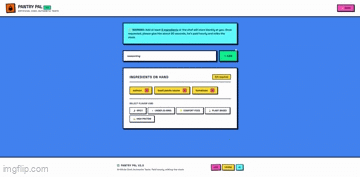

# Pantry Pal
Turn the ingredients you already have into your next meal with AI powered recipe recommendations. No stress, no complexity, just execution.

**Link to project:** https://pantry-pal-dusky.vercel.app/

    

**Tech used:** React, Tailwind, Vercel Serverless Functions, Groq SDK (`openai/gpt-oss-20b`)

 

## How It's Made:

Pantry Pal is built for the real world. It is an AI powered recipe generator that helps users discover meals using ingredients they already have in the kitchen. 

>Managing Ingredients with React

I used React state to keep track of user ingredients and dynamically update the UI in real time. 

Each ingredient can be individually removed so users can adjust their list on the fly. Conditional rendering handles the interface flow, making sure features unlock only when the user is ready. Simple, clean, and intuitive.

 

>Migrating to Groq & Securing Production with Vercel Serverless Functions

Originally powered by Hugging Face, I migrated my inference engine to Groq to leverage lightning fast LPU infrastructure. Early on, running AI calls straight from the frontend risked exposing API keys and hitting browser security walls.

I engineered a secure serverless proxy architecture:
- **The Client:** Frontend code sends the ingredient payload safely to an internal `/api/recipe` endpoint.
- **The Backend:** A Vercel Serverless Function (`api/recipe.js`) handles the heavy lifting on the server side, keeping the `GROQ_API_KEY` hidden from browser inspection.
- **The Engine:** Powered by Groq using the ultra efficient `openai/gpt-oss-20b` model. It is lean, fast, resource friendly, and stays safely within rate limits while serving hundreds of users.

Plus, I leverage `react-markdown` to transform raw text into beautifully rendered recipes.

 

>Managing Asynchronous Operations & Error States

Production apps need to be robust. I introduced structured loading states and error boundaries using `try`, `catch`, and `finally`. 

While the request is processing, the generation button locks down. No double submitting, no confusing bugs, and no wasted tokens. Clarity, confidence, code!

 

## Optimizations
- Introduce user accounts so people can save and revisit recipes they loved.
- Enhance styling and user experience.
- Scale up robust backend logging and analytics.

- *update: Added a loading icon because user experience matters!*

 

## Lessons Learned:

>Architecting for Production Security & Provider Migration

Transitioning my inference pipeline from Hugging Face to Groq and moving away from direct client side calls taught me the vital importance of serverless backend security. You cannot just throw keys in a frontend bundle and hope for the best when real people start using your app. Designing a proxy architecture protects your resources and keeps production bulletproof.

 

>Mastering Asynchronous Operations

Building reliable asynchronous flows ensures the UI always responds gracefully, whether the API succeeds, fails, or takes a second to think. 

 

>Dynamic UI & Markdown Rendering

Managing state cleanly in React keeps the application synchronized with user input, while rendering markdown turns raw AI output into a polished user interface.