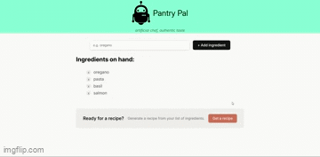

# Pantry Pal
Get recipe reccomendations from chef AI, 4 items are all you need to get started!

**Link to project:** https://pantry-pal-dusky.vercel.app/

    

## How It's Made:

**Tech used:** CSS, React, HuggingFace API (Mixtral-8x7B)

Users are greeted by my Instruction component, which prompts them to input at least 4 ingredients. From the moment the first ingredient is given, I leverage the power of React with conditional rendering based on logic from a ternary condition. The first introduces the Ingredients component, which keeps track of the ingredients shared so far and includes the option to delete each item separately in case of input errors or a change in direction desired by the user. Once at least 4 ingredients are received, the option to prompt the AI for a recipe is presented. Once satisfied with the list of ingredients, the list can be submitted as an array to Hugging Face, which hands the request to Mixtral-8x7B AI with the prompt `I have ${ingredientsString}. Please give me a recipe you'd recommend I make!`. I also included an error message in case I run out of API credits and need to refresh my key. Once the AI is finished, it sends back a response, which is turned into markup, thanks to the ReactMarkdown feature, and is rendered in the ClaudeRecipe component.

## Optimizations

The styling leaves much to be desired, but some would say a little bit of CSS goes a long way. Accounts could also be introduced to save previous recipes that users really enjoyed. A loading icon to indicate that submissions have been successfully received and that the response from the Hugging Face API is pending would also be a nice addition.

## Lessons Learned:

Messing around with the Hugging Face API was a great way to learn how to talk to AIs with code. I got a ton of practice passing props to various components, as well as practice using useState to dynamically update the list of ingredients rendered on the page.

